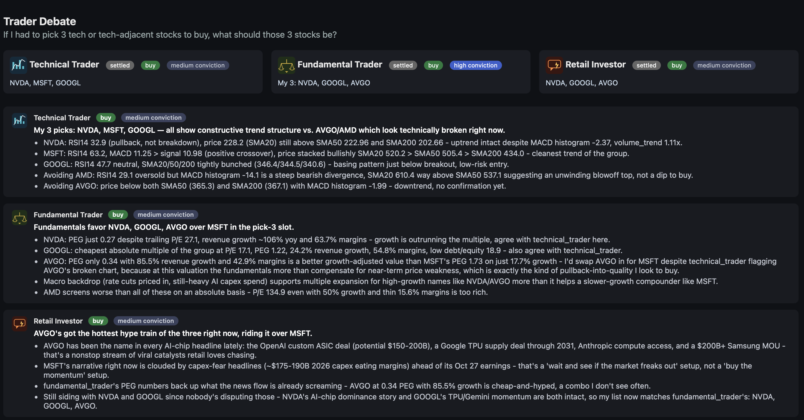

# The Trading Floor

Three AI traders. Same tickers, same market data, same starting cash — and three completely different philosophies about what actually moves a stock. Run them side by side and watch whose approach actually wins. Then make them argue about it, out loud, until they agree (or don't).

This isn't a backtest and it isn't a trading bot. It's a simulation you *watch think* — every decision comes with its reasoning attached, every trade has a receipt, and every disagreement plays out as an actual argument between agents who don't share a worldview.

**Paper trading only. No real brokerage, no real money, no real risk.**

## Meet the traders

| | Believes in | Ignores |
|---|---|---|
| 📈 **Technical Trader** | RSI, MACD, moving averages, volume — price action and nothing else | Fundamentals, news, hype |
| 🧮 **Fundamental Trader** | P/E, PEG, margins, debt, macro backdrop — is the business actually worth this? | Charts, momentum, headlines |
| 📰 **Retail Investor** | News, sentiment, what's trending, what's moving — and says so honestly | Deep analysis of any kind |

Same universe of stocks. Same real market data pulled live via `yfinance`. Three completely independent decisions, every round. One of them is usually right. It's rarely the one you'd expect.

## Watch them disagree

The real fun starts when you don't just run a round — you ask them to **debate**.

> Debate: Should I buy NVIDIA right now?

The three traders open a live argument: opening positions, rebuttals, people actually changing their minds mid-debate (and saying so explicitly when they do), and a real-time browser view where you can watch the whole thing unfold turn by turn — complete with each trader's stance (buy/hold/sell) and conviction (high/medium/low), so you're never left guessing whether "I'd be cautious here" means buy or don't.

Debates don't always converge. Sometimes two traders agree and one holds out to the very end on principle — and that's the most interesting outcome of all, because it tells you *exactly* where the disagreement actually lives (a chart that hasn't confirmed yet vs. a valuation that already has, say). You can even throw genuinely hard questions at them:

> Debate: If I had to pick 3 tech stocks to buy, what should those be? Keep debating until all three of you agree.

Sometimes they get there. Sometimes they get to 2 out of 3 and dig in — and you get to see exactly why, argued out in full, rather than averaged into a meaningless consensus.



*Live from an actual run: the technical trader holds out for MSFT on a broken chart, while the fundamental and retail traders converge on AVGO — each one citing hard numbers, not vibes, and you can watch the stance/conviction badges update turn by turn as positions shift.*

## Why this exists

Not to predict the market. To make a question concrete: **does a disciplined technical approach actually beat a fundamentals-first one? Does chasing momentum lose money over time, or does it just feel riskier?**

Run enough rounds and you stop having to guess. You get an actual, inspectable track record per philosophy — every trade logged with its stated reasoning, every portfolio marked to market, every agent's return measured against its own buy-and-hold benchmark so you can tell skill from luck. Ask for a performance review at any point and get a dated, numbers-first verdict on who's actually earning their edge and who's just along for the ride.

It's a way to *see* investing philosophies compete, instead of just reading about them.

## Getting started

**Prerequisite:** this runs inside [Claude Code](https://claude.com/claude-code) — the traders are Claude Code subagents, not a standalone app. Install and sign in to Claude Code first if you haven't already.

```bash
git clone https://github.com/sayantan92sanyal/stock-trading-simulation-agents.git
cd stock-trading-simulation-agents

python3 -m venv .venv
.venv/bin/pip install --upgrade pip
.venv/bin/pip install -r requirements.txt
.venv/bin/python3 -m pytest -v   # confirm everything's wired up
```

Then launch Claude Code in this directory (`claude`) and just talk to the `trading-boss` agent (via Claude Code's Agent tool, `subagent_type: "trading-boss"`):

```
Run a trading round on AAPL, MSFT, GOOGL
```
```
Run a round on energy stocks
```
```
Debate: Should I buy Coca-Cola shares?
```
```
Review the agents' performance so far
```

Each trader starts with $50,000 in virtual cash. Everything — portfolios, trade history, debate transcripts, performance log — lives in `data/`, which is gitignored: it's your local run, not part of the repo.

## How it's built

Every decision is made by an LLM agent. Every dollar is moved by deterministic code. The two never blur:

- **`trading-boss`** — the orchestrator, and the only agent you talk to directly. Resolves the ticker universe, dispatches the three traders, and reports back.
- **`technical-trader`** / **`fundamental-trader`** / **`retail-investor`** — the three personas above. Each one executes its own trades directly against the ledger and, in debate mode, posts its own turns directly — no fragile hand-off where a decision could get lost in translation.
- **`performance-reviewer`** — runs only when you ask. Computes real returns, a buy-and-hold benchmark per agent, and a plain-English verdict.
- **`scripts/portfolio.py`** — the ledger. All cash and share math happens here, in plain Python, never inferred by a model.
- **`scripts/debate.py`** — the debate engine. Deterministic turn rotation, stance/conviction tracking, a 5-minute timeout so nobody argues forever.
- **`scripts/market_data.py`** / **`scripts/indicators.py`** — live quotes, fundamentals, news, and technical indicators, all pulled from `yfinance`. No paid API keys required.
- **`web/viewer.html`** — a live, auto-refreshing browser view of any debate in progress, opened automatically when a debate starts.

Long-only cash equities. No shorting, no margin, no options. The stock universe is always supplied by you — nothing is ever hard-coded.

Curious about the design decisions behind any of this? `docs/superpowers/specs/` and `docs/superpowers/plans/` have the full write-ups for the trading simulation and the debate feature.

---

### ⚠️ Experimental project — not investment advice

This is a sandbox for watching simulated agents reason and compete against each other, built for curiosity and learning. Nothing here is financial advice, a recommendation, or a signal to act on with real money. The traders can be wrong — often confidently so — and the simulation makes no claim about what will happen in real markets. Use it to explore ideas, not to make investment decisions.
